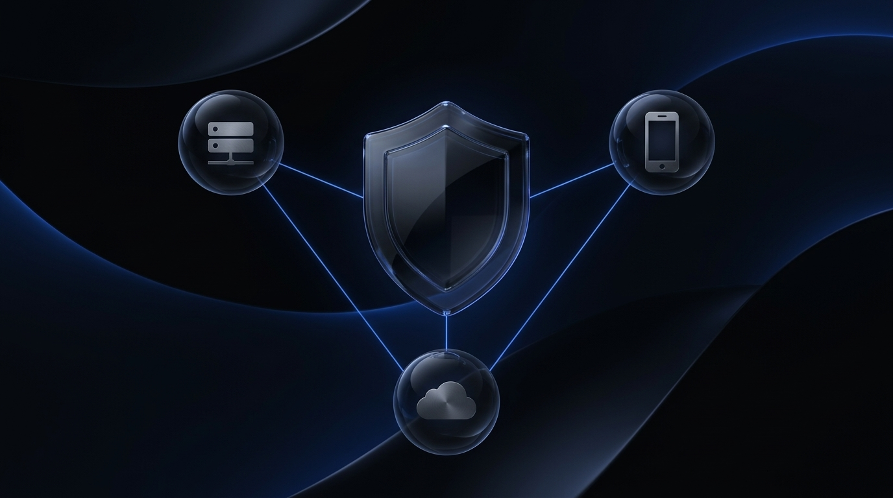

<p align="center">
  
</p>

<h1 align="center">OMEGA Security v2.0.1</h1>

<p align="center">
  <strong>Anti-Spyware · Mobile Forensics · Zero-Retention RAG · Native Rust Sensor</strong>
</p>

<p align="center">
  Lanzamiento de endurecimiento DevSecOps, pipeline SAST automatizado con <strong>CodeQL + Semgrep</strong>, contenedores no privilegiados y unificación completa de versiones v2.0.1 para Windows, macOS y Linux.
</p>

---

<p align="center">
  
</p>

## Lo más destacado en `v2.0.1`

### 1. Blindaje DevSecOps y Enforcement SAST real (`PR #1`)
- **CodeQL (`security-extended`) + Semgrep OSS en CI:** análisis continuo multi-lenguaje (`Java 21`, `Python 3.12`, `JavaScript/React`, `Rust`, `Dockerfiles` y `GitHub Actions`) con subida SARIF a **GitHub Code Scanning**.
- **Evaluador fail-closed por fingerprint SHA-256 (`.github/scripts/evaluate_semgrep_gate.py`):** bloquea automáticamente hallazgos nuevos de severidad `ERROR`, rechaza reportes corruptos o errores fatales del escáner e impide que vulnerabilidades nuevas hereden excepciones pasadas (validado por 6 pruebas unitarias en CI).
- **Cadena de suministro inmutable en CI/CD:** todas las acciones de GitHub fijadas a **SHAs de commit de 40 caracteres**, aislamiento seguro para PRs desde forks y actualizaciones semanales automatizadas con **Dependabot**.

### 2. Contenedor Web Endurecido (Non-Root Nginx + Host Hardening)
- **Ejecución sin privilegios (`nginxinc/nginx-unprivileged:1.27-alpine`):** el frontend en contenedor corre estrictamente como usuario `nginx` (`UID 101`) escuchando en el puerto interno `8080` (mapeado como `${FRONTEND_PORT:-5173}:8080` en Compose).
- **Protección contra Host Header Injection y ocultación de versión:** proxy inverso endurecido con `Host backend-java:8080` y `server_tokens off`, validado funcionalmente con fallback SPA, assets inmutables y cabeceras `X-Forwarded-*`.

### 3. Versionado Unificado y Experiencia Desktop Nativa (`2.0.1`)
- Alineadas las versiones de **Tauri v2**, **sensor nativo Rust (`omega-sensor`)**, **frontend (`package.json`)** y **flota SaaS** en `2.0.1`.
- Auto-orquestación Docker transparente en modo `SELF_HOSTED` por defecto y conmutación automática a `CLOUD_MANAGED` HTTPS sin Docker cuando se define `OMEGA_BACKEND_URL`.

---

<p align="center">
  
</p>

## Instalación rápida por plataforma

| Plataforma | Instalador recomendado | Notas |
| :--- | :--- | :--- |
| **Windows (x64)** | `OMEGA.Security_2.0.1_x64-setup.exe` *(NSIS)* · `.msi` *(WiX GPO)* | App nativa Tauri v2 (~3.5–4.9 MiB) con icono oficial `Ω` y sensor Rust `omega-sensor.exe` integrado |
| **macOS** | `.dmg` | Paquete nativo WKWebView + sidecar Rust |
| **Linux** | `.AppImage` · `.deb` | Paquete portable y Debian/Ubuntu |

> **Nota de confianza y firma:** Todos los binarios incluyen manifiesto verificable `SHA256SUMS.txt` y atestación de procedencia **Sigstore / SLSA** generada por GitHub Actions. En Windows y macOS, los avisos de SmartScreen/Gatekeeper aplicarán mientras no se carguen certificados comerciales Authenticode / Apple Developer ID en los secretos del repositorio.

---

## Verificación de integridad

```powershell
# Windows (PowerShell)
Get-FileHash .\OMEGA.Security_2.0.1_x64-setup.exe -Algorithm SHA256
```

```bash
# macOS / Linux
sha256sum -c SHA256SUMS.txt
```

Para detalles completos sobre la arquitectura SAST, línea base y operación diaria consulta [`docs/sast-security.md`](https://github.com/andresguerra321/OMEGA/blob/main/docs/sast-security.md).
