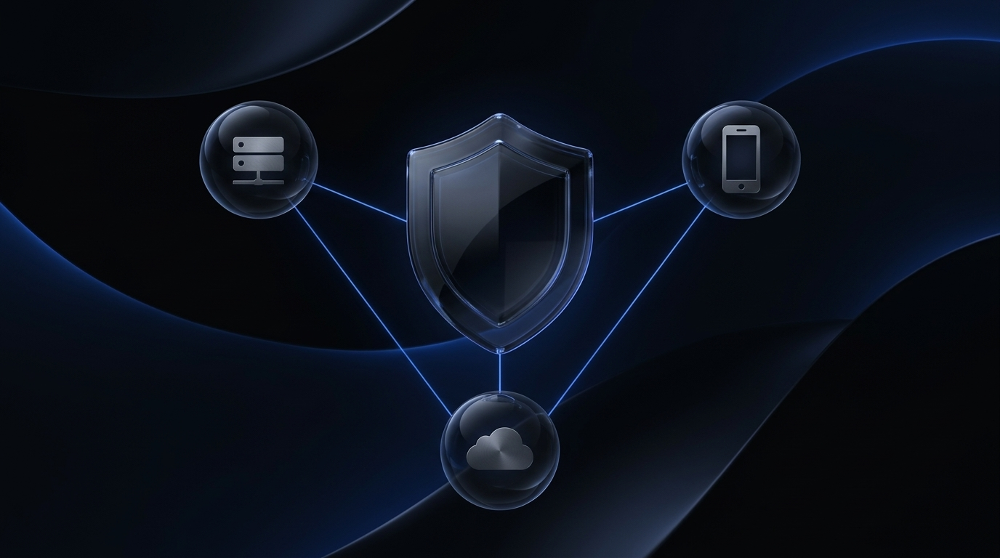

<p align="center">
  
</p>

<h1 align="center">OMEGA Security v2.0.3</h1>

Arranque autónomo del gateway Docker local desde los instaladores nativos Tauri v2, empaquetado de recursos Self-Hosted y visibilidad en tiempo real del estado de servicios.

## Novedades y correcciones incluidas

- **Arranque autónomo de contenedores (`docker_bootstrap.rs`):** el instalador nativo ahora genera y persiste de forma segura una sola vez `INTERNAL_SERVICE_TOKEN` y `OMEGA_JWT_SECRET` mediante `getrandom` en el directorio de datos de la aplicación, corrige rutas `\\?\` en Windows y levanta únicamente `postgres`, `forensic-worker` y `backend-java` (sin reconstruir un frontend redundante) con timeout de hasta 20 minutos para el primer build local.
- **Recursos Self-Hosted incluidos en el instalador (`stage_desktop_resources.py`):** los instaladores empaquetan una copia limpia de `docker-compose.yml`, `db/init.sql`, `api/`, `backend-java/` y `corpus_mvp/` dentro del bundle Tauri sin arrastrar archivos `.env` ni cachés de desarrollo.
- **Banner de estado y reconexión automática (`DesktopBootstrapBanner`):** muestra el progreso del arranque de contenedores o errores accionables (por ejemplo, Docker Desktop apagado) con botón **Reintentar**, revalidando automáticamente el gateway en cuanto queda operativo.
- **Continuidad de v2.0.2:** conserva el puente USB nativo Android/iOS en Rust, la protección CSRF web y CORS estricto para los orígenes Tauri.

<p align="center">
  
</p>

## Descargas

| Plataforma | Instaladores |
| --- | --- |
| Windows x64 | `OMEGA.Security_2.0.3_x64-setup.exe` y `.msi` |
| macOS Apple Silicon | `.dmg` para aarch64 |
| Linux x64 | `.AppImage` y `.deb` |

Se adjuntan el banner y los dos visuales oficiales del repositorio. `MEDIA_SHA256SUMS.txt` permite verificar estos archivos y `SHA256SUMS.txt` los instaladores.

## Uso rápido del instalador Self-Hosted

1. Asegúrate de tener **Docker Desktop** (o Docker Engine) iniciado antes de abrir la aplicación.
2. En el primer arranque, OMEGA construirá localmente las imágenes de `backend-java` y `forensic-worker` (puede tardar varios minutos dependiendo de la conexión y CPU); el banner superior mostrará el avance hasta conectar con el gateway.
3. Si prefieres conectar contra un servidor existente en la nube (`CLOUD_MANAGED`), define `OMEGA_DEPLOYMENT_MODE=CLOUD_MANAGED` y `OMEGA_BACKEND_URL`.

## Verificación de integridad

```powershell
Get-FileHash .\OMEGA.Security_2.0.3_x64-setup.exe -Algorithm SHA256
```

La atestación de procedencia se genera mediante GitHub Actions (`release-integrity` / Sigstore SLSA). Una firma comercial Authenticode o Apple Developer ID solo está presente si el repositorio tiene configurados los certificados correspondientes.

<p align="center">
  
</p>
