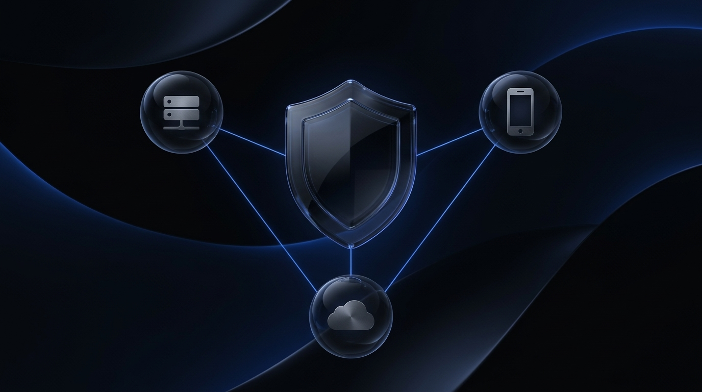

  

<h1 align="center">OMEGA Security v2.0.4</h1>

Experiencia local completa lista para usar nada más abrir el instalador `.exe`: validación estricta de imágenes Docker, configuración persistente de IA y SMTP desde la interfaz de escritorio y flujo honesto de acceso sin servidor de correo externo.

## Novedades y correcciones incluidas

- **Validación de imágenes y reconstrucción automática (`docker_bootstrap.rs`):** el instalador ya no reutiliza a ciegas imágenes antiguas cacheadas (como compilaciones previas sin `healthcheck.py`). Comprueba `io.omega.version`, la salud de `omega_forensic_worker` y el marcador `built-images.json`, ejecutando `--build` cuando la versión o los contenedores están desactualizados.
- **Ajustes locales nativos en Tauri (`desktop_config.rs`, `SettingsPanel.jsx`):** permite configurar proveedor de IA (**Groq**, **Ollama Soberano Local**, **Gemini**, **OpenAI** o **OmniRoute**) y opcionalmente tu servidor **SMTP** desde la app sin editar archivos `.env` a mano; las credenciales se guardan localmente en `app_data_dir/desktop-config.json` sin exponerse al frontend.
- **Acceso y recuperación transparentes en modo local (`AuthController.java`, `AuthModulePanel.jsx`):** evita el falso mensaje de "Sin conexión" mientras Docker está preparando los contenedores, expone `smtpConfigured` en `/api/v1/auth/config` y advierte con honestidad en recuperación de contraseña cuando el nodo local aún no tiene SMTP configurado (recordando que **Crear cuenta** funciona al instante sin correo ni nube).
- **CI Linux endurecido:** [release-desktop.yml](.github/workflows/release-desktop.yml) utiliza espejos HTTPS IPv4 estables (`mirrors.edge.kernel.org`) para los runners Ubuntu.

  

## Descargas

| Plataforma | Instaladores |
| --- | --- |
| Windows x64 | `OMEGA.Security_2.0.4_x64-setup.exe` y `.msi` |
| macOS Apple Silicon | `.dmg` para aarch64 |
| Linux x64 | `.AppImage` y `.deb` |

Se adjuntan el banner y los dos visuales oficiales del repositorio. `MEDIA_SHA256SUMS.txt` permite verificar estos archivos y `SHA256SUMS.txt` los instaladores.

## Cómo usar OMEGA 100 % local tras descargar

1. Abre **Docker Desktop** y ejecuta el instalador `OMEGA.Security_2.0.4_x64-setup.exe`.
2. Espera a que el banner superior termine de validar/construir y levantar `postgres`, `forensic-worker` y `backend-java`.
3. En la pantalla inicial, entra por **Crear cuenta** (no requiere verificación por correo) para crear tu espacio privado local.
4. Dentro de la app, abre **Ajustes → Motor de IA** si deseas activar **Ollama local**, **Groq** u otro modelo, y configura **Correo SMTP local** si quieres recibir códigos de recuperación/2FA por email.

  

